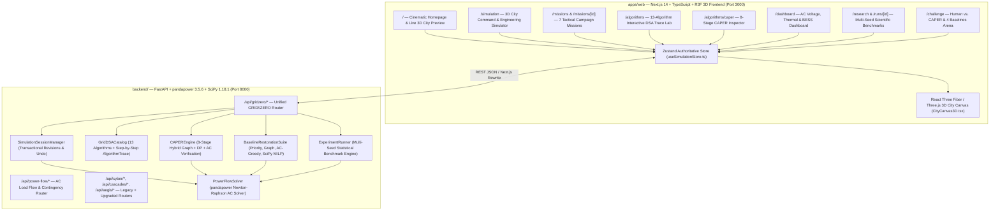

# GRIDSEC // ZERO — System Architecture & Engineering Specification

**Parent Platform:** GRIDSEC — Power Grid Cybersecurity & Resilience Platform  
**Flagship Module:** **GRID//ZERO — THE CITY MUST STAY ALIVE**  
**Subtitle:** *Cyber-Physical Grid Resilience, Intelligent Critical-Load Restoration & Explainable Graph Optimization*

---

## 1. High-Level Hybrid Monorepo Architecture

The repository implements a unified hybrid monorepo combining the modern **GRID//ZERO** Next.js 14 + TypeScript + React Three Fiber 3D application (`apps/web/`) with the expanded Python 3.13 + FastAPI + `pandapower` AC physics + SQLite backend (`backend/`), while preserving 100% of legacy GRIDSEC HTML/JS views (`index.html`, `app.html`, `game.html`).



---

## 2. Directory Structure

```text
Cyber_Project/
├── apps/
│   └── web/                                  # Next.js App Router + TypeScript + Tailwind + R3F
│       ├── src/
│       │   ├── app/                          # 15 Application Routes
│       │   │   ├── page.tsx                  # / (Homepage & Live 3D City Preview)
│       │   │   ├── simulation/page.tsx       # /simulation (3D City Command Center)
│       │   │   ├── missions/page.tsx         # /missions (7 Campaign Missions Catalog)
│       │   │   ├── missions/[id]/page.tsx    # /missions/[id] (Playable Mission Cockpit)
│       │   │   ├── algorithms/page.tsx       # /algorithms (13-Algorithm DSA Trace Lab)
│       │   │   ├── algorithms/caper/page.tsx # /algorithms/caper (8-Stage CAPER Inspector)
│       │   │   ├── dashboard/page.tsx        # /dashboard (Power Engineering Dashboard)
│       │   │   ├── research/page.tsx         # /research (Multi-Seed Benchmark Suite)
│       │   │   ├── runs/[id]/page.tsx        # /runs/[id] (Individual Run Trial Ledger)
│       │   │   ├── challenge/page.tsx        # /challenge (Human vs. AI Arena)
│       │   │   ├── national-grid/page.tsx    # /national-grid (India 59-Bus & IEEE 30-Bus)
│       │   │   ├── cyber-lab/page.tsx        # /cyber-lab (GOOSE / FDIA / Aegis Defense)
│       │   │   ├── sandbox/page.tsx          # /sandbox (Open-Ended Topology Sandbox)
│       │   │   ├── docs/page.tsx             # /docs (Interactive System Documentation)
│       │   │   └── demo/page.tsx             # /demo (5-Minute Faculty Walkthrough)
│       │   ├── components/
│       │   │   ├── city3d/CityCanvas3D.tsx   # Procedural 3D City, Feeders, Switches & HUD
│       │   │   ├── layout/TopNavBar.tsx      # Global SCADA Header & Telemetry Strip
│       │   │   └── simulation/EngineeringInspector.tsx
│       │   ├── data/missionsCatalog.ts       # Authoritative 7 Missions Specification
│       │   └── store/useSimulationStore.ts   # Zustand Transactional Client Store
├── backend/
│   ├── app/
│   │   ├── api/routes/gridzero.py            # Unified GRID//ZERO REST API
│   │   ├── dsa/
│   │   │   ├── trace.py                      # AlgorithmTrace & AlgorithmTraceStep Schemas
│   │   │   ├── algorithms_catalog.py         # All 13 DSA Implementations & Trace Generators
│   │   │   ├── graph.py, bfs.py, dfs.py, dijkstra.py, hashing.py, priority_queue.py
│   │   ├── power/
│   │   │   ├── models.py                     # Bus, Line, Switch, Battery, Fault & Provenance Models
│   │   │   ├── distribution_networks.py      # TRAINING_FEEDER (12-Bus) & IEEE_33_DISTRIBUTION
│   │   │   ├── ieee30_network.py             # IEEE 30-Bus Transmission Benchmark
│   │   │   ├── solver.py                     # pandapower Newton-Raphson AC Power-Flow Engine
│   │   │   └── power_flow_service.py         # Candidate AC Cloning & Validation Service
│   │   ├── restoration/
│   │   │   ├── caper.py                      # 8-Stage CAPER Algorithm Engine
│   │   │   └── baselines.py                  # Priority, Graph, AC-Greedy & SciPy HiGHS MILP
│   │   ├── simulation/
│   │   │   ├── session_manager.py            # Authoritative Session & 3D Building State Manager
│   │   │   └── missions.py                   # 7 Playable Missions & Human-vs-AI Evaluator
│   │   └── experiments/
│   │       └── runner.py                     # Reproducible Multi-Seed Benchmark Suite & CSV Export
│   └── test_gridzero_complete.py             # End-to-End Backend Pytest Verification Suite
└── docs/
    ├── upgrade/BASELINE_AUDIT.md             # Pre-Upgrade Repository & Test Audit
    └── screenshots/                          # 16 Verified Playwright Application Screenshots
```

---

## 3. Single Authoritative Simulation State

All three experiences (**The 3D Game**, **The Engineering Simulator**, and **The Research Laboratory**) operate on the same `SimulationSessionState` managed by `SimulationSessionManager`:
- Every switch toggle, fault injection, BESS dispatch (`kW`), load curtailment (`MW`), or upstream capacity limit (`MW`) increments an atomic `revision` counter, pushes a snapshot onto the undo stack, solves a full `pandapower` Newton-Raphson AC load flow, and updates the 3D city building states (`ENERGIZED`, `BACKUP_BATTERY`, `CURTAILED`, `BLACKOUT`, `SOURCE_ACTIVE`).

