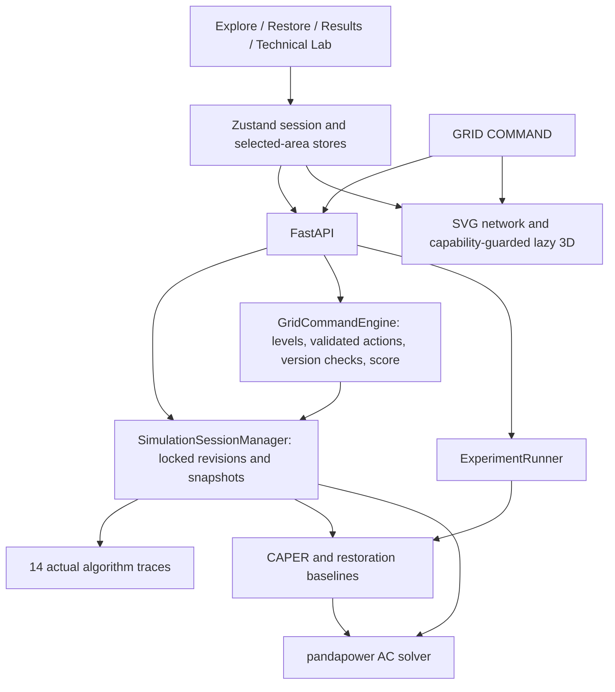

# Architecture

GRIDSEC remains one repository and one modern application: Next.js/React/Zustand in `apps/web`, FastAPI in `backend`, and the preserved legacy HTML/JS applications. The Next.js API rewrite forwards `/api/*` to the backend. No independent replacement application or mock result service was introduced.

## State ownership

`SimulationSessionState` contains the network identity, revision, simulation time, faults, actual switches, batteries, overrides, AC results, facility states, KPIs and action log. `SimulationSessionManager` computes the state after each accepted action. A reentrant lock prevents two in-process operations from losing updates. Invalid targets and numeric bounds raise structured errors without committing a revision. An existing named session is retained when an internal lookup does not request another network.

The local engineering tools intentionally share their operator session through `useSimulationStore`. Initial reference geometry is marked `REFERENCE_PREVIEW`; global connection/error feedback prevents it from masquerading as a solved electrical state. Restoration case-study snapshots retain the before state, chosen evidence, same-initial-condition comparison and applied state in browser session storage. They are kept separately so navigation cannot silently rewrite historical evidence.

`useIndiaGridStore` owns a distinct named national session, geographic selection, modeled scope and history. Explore, national operations and the dashboard read the same selection and solved state. `gridMetrics.ts` derives the displayed scope metrics, bounds allocations by demand and excludes disconnected assets. Geographic drill-down to the training feeder is explicitly educational and separate.

## GRID COMMAND

The game uses the same session-manager class, training network, solver and DSA/CAPER implementation through its own named sessions. The server owns turn budgets, repair credits, deterministic storm events, scoring, initial snapshots, undo history and accepted moves. `/api/grid-command/*` validates actions and expected versions. Game and physical bookkeeping roll back together on failure. The frontend renders returned snapshots and does not compute a separate electrical result.

A game can repair a branch, operate a real switch, dispatch the modeled solar generator or finite BESS, allocate flexible demand and set an intake budget. Completion requires the objectives and hard AC operating limits. CAPER comparisons use the original scenario, even after human repairs. See [game rules](docs/GRID_COMMAND.md) for costs, scoring and exact controls.

## Rendering lifecycle

Every modern Three.js initialization runs through `CityCanvas3D`. A cached WebGL2 capability probe precedes lazy import of `CityRenderer3D`; its temporary context is released. Unsupported graphics, renderer errors or context loss choose the shared SVG `FeederDiagram`. Failures persist for the browser session, preventing repeated initialization. Scene DPR is bounded, rendering is demand-driven and hidden tabs suspend scene rendering. Renderer controls/listeners and scene resources follow the mounted canvas lifecycle.

The SVG view uses the same authoritative facilities, lines, transformers, switches and trace IDs as the 3D scene. It supports keyboard selection, inspection, pan/zoom and overlays. Games and the main explanatory flow can stay in 2D regardless of GPU support.

## Analysis and provenance

The original 13 DSA implementations remain; source–critical-load bipartite matching is an additional traceable planning algorithm. Max-flow retains its compatibility API identifier `MIN_COST_MAX_FLOW`, but its UI and documentation accurately identify the implementation as Edmonds–Karp max-flow/min-cut, not minimum-cost optimization. Algorithms inspect current faults, switching, source budgets and allocation where applicable. Candidate routing may include operable open ties; those are proposals requiring switching and subsequent AC validation.

Cyber analysis runs the existing detector API on a separate IEEE 30-bus sandbox. Its response contains actual classification, physical-state comparison, BFS impact, incident prioritization and execution evidence. Local synthetic feeder exercises are labeled separately and no longer invent successful IDS residual tests or restoration percentages.

Research summaries and CSV exports come from computed ExperimentRunner records. Missing data produces loading/error/empty states; fabricated leaderboard and statistical fallbacks have been removed. Raw demand percentages that include infeasible attempts are qualified as attempted supply.

## Deployment limits

This is a local-process engineering product. Session/research/game records are in memory; game IDs alone are retained by the browser. Server restarts expire games. Locks and expected versions protect one process; distributed storage and cross-worker transactions, authentication, production monitoring and live national telemetry are not implemented. Run a single backend worker for the supplied experience. These constraints must be resolved before operating a public multiplayer or utility-facing service.
