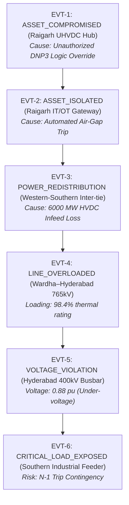

# GRIDSEC — Cyber-Physical Power Grid Resilience Architecture Specification

## Executive Overview

**GRIDSEC** is architected to seamlessly unify the **Physical Electrical Layer** (Power Flow, Busbar Voltages, Branch Loadings, Transformer States, Dissolved Gas Analytics) and the **Cyber Security Layer** (SCADA Telemetry, Intrusion Detection, DNP3/Modbus Protocol Anomalies, Incident Priority Queues) through a shared **Unified Event Bus**, an asynchronous **Cascading Failure Engine**, and **Aegis AI Real-Time Situation Analysis**.

---

## 1. Unified Event Model & Event Bus

Every significant state alteration across cyber or physical assets is represented as a strongly-typed, immutable `GridEvent`.

```
+-----------------------------------------------------------------------------+
|                               UNIFIED GRID EVENT                            |
|                                                                             |
|  • event_id:         Unique identifier (e.g., EVT-CP-9812A)                 |
|  • timestamp:        UTC ISO-8601 millisecond synchrophasor timestamp       |
|  • event_type:       Standardized event category                            |
|  • source_asset:     Originating Substation, Line, or Switchyard bay        |
|  • affected_assets:  Array of downstream impacted asset identifiers         |
|  • severity:         CRITICAL | HIGH | MEDIUM | LOW | INFO                  |
|  • cause:            Immediate trigger / physical or cyber anomaly vector   |
|  • parent_event_id:  Link to antecedent event (constructing causal graph)   |
|  • simulation_id:    Null for live grid; isolated ID for sandboxes          |
|  • data_source:      Originating engine / PMU / SCADA stream                |
|  • payload:          Domain-specific electrical / cyber telemetry           |
+-----------------------------------------------------------------------------+
```

### Standardized Event Types:
- **Cyber Domain**: `ASSET_COMPROMISED`, `ASSET_ISOLATED`, `SCADA_ANOMALY`, `UNAUTHORIZED_ACCESS`, `COMMAND_INJECTION`
- **Electrical Physics Domain**: `LINE_FAILED`, `LINE_OVERLOADED`, `TRANSFORMER_OVERLOADED`, `TRANSFORMER_TRIPPED`, `VOLTAGE_VIOLATION`, `FREQUENCY_DEVIATION`, `POWER_REDISTRIBUTION`, `ROUTE_CHANGED`, `CRITICAL_LOAD_EXPOSED`, `ISLAND_FORMED`
- **Incident Management**: `INCIDENT_CREATED`, `INCIDENT_ESCALATED`, `INCIDENT_RESOLVED`

---

## 2. Event Causality & Root-Cause Chains

To answer the fundamental question: *"Why did this blackout / overload occur?"*, events preserve an explicit causal DAG (Directed Acyclic Graph) via `parent_event_id`.



---

## 3. Cascading Failure Chain Model

Multi-hop propagation sequences are managed through `Cascade` and `CascadeEvent` relational entities:

- **`Cascade`**:
  - `cascade_id`: e.g. `CAS-2026-003`
  - `simulation_id`: Sandboxed scenario or Live grid
  - `root_event_id`: Genesis event ID
  - `current_depth`: Integer hop level reached (1 to $N$)
  - `status`: `ACTIVE`, `PROPAGATING`, `CONTAINED`, `TERMINATED`
  - `impacted_capacity_mw`: Cumulative capacity at risk
- **`CascadeEvent`**:
  - Sequence tracking table maintaining `(cascade_id, event_id, parent_event_id, depth, sequence_number)`.

---

## 4. Simulation State Isolation (Baseline vs. Sandboxes)

To guarantee that exploratory "what-if" cyber drills or extreme stress tests never corrupt the reference Indian grid catalog, GRIDSEC enforces **State Isolation**:

```
                         BASE INDIAN GRID (Immutable)
                       [59 Assets, 54 Corridors, 85 XFMRs]
                                      │
               ┌──────────────────────┼──────────────────────┐
               ▼                      ▼                      ▼
        SIMULATION ALPHA       SIMULATION BETA        SIMULATION GAMMA
        (Raigarh Breach)       (Line 17 Trip)         (Delhi Islanding)
        • Isolated State       • Isolated State       • Isolated State
        • Overrides Map        • Overrides Map        • Overrides Map
        • Scoped Event Bus     • Scoped Event Bus     • Scoped Event Bus
```

- Base Grid: `status = HEALTHY`, `risk_score = 5.0`
- Simulation `SIM-2026-CAE274`: `state_overrides = {"WR-RAIGARH": {"status": "COMPROMISED", "risk_score": 85.0}}`
- Running a sandbox recalculation never mutates the underlying baseline tables.

---

## 5. Aegis AI Input Layer ("Situation Snapshot")

Aegis does not query raw relational database tables. Instead, it consumes a structured, strongly-typed **`SituationSnapshot`** produced by [backend/app/services/aegis_service.py](file:///c:/Users/karti/Desktop/sem3/dsa/Project/backend/app/services/aegis_service.py):

```json
{
  "timestamp": "2026-09-06T16:10:00.000Z",
  "grid_state": {
    "health_score": 98.3,
    "total_generation_mw": 207596.6,
    "total_load_mw": 204047.9,
    "total_losses_mw": 6643.1,
    "grid_frequency_hz": 50.002,
    "monitored_nodes_count": 59,
    "compromised_nodes_count": 1
  },
  "active_incidents": [...],
  "active_threats": [...],
  "critical_assets": [...],
  "affected_assets": [{"asset_id": "WR-RAIGARH", "status": "COMPROMISED"}],
  "overloaded_lines": [...],
  "voltage_violations": [],
  "cascade": {
    "active": true,
    "cascade_id": "CAS-2026-001",
    "depth": 3,
    "events_count": 5,
    "impacted_capacity_mw": 40900.0
  },
  "available_routes": [
    {
      "route_type": "ALTERNATE_TRANSMISSION_BYPASS",
      "source": "WR-RAIGARH",
      "target": "SR-PUGALUR",
      "distance_km": 1830.0,
      "headroom_mw": 6000.0
    }
  ],
  "recommended_actions": [
    {
      "action_id": "ACT-ISO-01",
      "priority": "HIGH",
      "action_type": "BREAKER_ISOLATION_DRILL",
      "description": "Isolate IT/OT SCADA interface at Raigarh UHVDC Hub",
      "requires_operator_confirmation": true
    }
  ]
}
```

---

## 6. Aegis AI Output Schema & Versioned Reports

Aegis emits versioned `AegisReport` objects supporting continuous refinement as an incident unfolds (Version 1: Intrusion Detected $\rightarrow$ Version 2: Impact Identified $\rightarrow$ Version 3: Alternative Route Computed).

```json
{
  "report_id": "RPT-AEGIS-2026-B38A35",
  "version": 1,
  "severity": "CRITICAL",
  "summary": "Aegis Situation Assessment: 1 substation(s) currently marked at-risk. Cascading cyber-physical blast radius encompasses 11 nodes and 40,900 MW capacity.",
  "situation": "The national transmission network is operating at 98.3% health. Active demand stands at 204,047.9 MW against 207,596.6 MW total generation.",
  "impact": "40,900 MW transmission throughput at elevated risk",
  "cause": "SCADA Telemetry Anomaly / Cyber Intrusion Vector",
  "prediction": "Without proactive load shedding or dynamic rerouting, thermal loading may trigger secondary breaker trips.",
  "confidence": 0.92,
  "status": "GENERATED",
  "evidence": [
    {
      "claim": "Cyber-physical cascading risk identified across multi-hop transmission paths.",
      "evidence": [
        "BFS blast impact score: 100/100 originating from WR-RAIGARH",
        "Substations within 3-hop topological blast radius: 11",
        "Cumulative transmission capacity at risk: 40900.0 MW",
        "Connected synchronous islands detected: 7"
      ]
    }
  ],
  "recommendations": [...]
}
```

---

## 7. Real-Time Event & WebSocket Pipeline

```
                              REAL-TIME EVENT PIPELINE
                                          │
                                          ▼
                                   [ EVENT BUS ]
                                          │
                    ┌─────────────────────┴─────────────────────┐
                    ▼                                           ▼
             [ DATABASE ]                               [ CASCADE ENGINE ]
             (grid_events)                                      │
                                                                ▼
                                                        [ STATE UPDATE ]
                                                                │
                                                                ▼
                                                       [ SITUATION SNAPSHOT ]
                                                                │
                                                                ▼
                                                        [ AEGIS SERVICE ]
                                                                │
                                                                ▼
                                                    [ WEBSOCKET (/ws/aegis) ]
                                                                │
                                                                ▼
                                                        [ REACT FRONTEND ]
```

---

## 8. DSA Integration Framework

Aegis consumes structured DSA analytics directly:
- **BFS Engine** $\rightarrow$ Computes topological cascading blast radius, hop depth, and cumulative MW at risk.
- **Dijkstra Engine** $\rightarrow$ Computes multi-objective alternate bypass routes around quarantined or congested corridors.
- **DFS Engine** $\rightarrow$ Detects synchronous island formation and closed mesh transmission loops.
- **Priority Queue (Binary Max-Heap)** $\rightarrow$ Ranks incoming incidents by composite risk score in $O(1)$ peek / $O(\log N)$ extraction.
- **Multi-Key Inverted Index Hash Table** $\rightarrow$ Provides instantaneous $O(1)$ asset lookup by ID, pincode, district, operator, and type.

---

## 9. Future Power-Flow Solver Integration

When pandapower / Newton-Raphson executes, physical branch overloads and voltage violations directly emit events into the bus:

```
               [ Electrical Power-Flow Calculation ]
                                 │
            ┌────────────────────┴────────────────────┐
            ▼                                         ▼
   [ Branch Loading > 90% ]                  [ Bus Voltage < 0.90 pu ]
            │                                         │
            ▼                                         ▼
   Emit: LINE_OVERLOADED                     Emit: VOLTAGE_VIOLATION
            │                                         │
            └────────────────────┬────────────────────┘
                                 ▼
                         [ EVENT BUS ]
                                 │
                                 ▼
                      [ CASCADING ENGINE ]
                                 │
                                 ▼
                         [ AEGIS REPORT ]
```

---

## 10. Operator Safety Boundaries & Guardrails

> [!IMPORTANT]
> **Aegis AI is strictly an operator decision-support advisory system.**
> Aegis does NOT directly actuate SCADA circuit breakers, change transformer tap positions, or execute generator dispatch commands.
> All recommended actions carry `requires_operator_confirmation = true` and must be explicitly reviewed and acknowledged by authorized grid dispatchers.

---

## 11. Complete REST API Surface

| Method | Endpoint | Description |
| :--- | :--- | :--- |
| `GET` | `/api/aegis/situation` | Structured real-time Situation Snapshot |
| `GET` | `/api/aegis/events` | Unified event feed for Aegis streaming |
| `GET` | `/api/aegis/reports` | List historical and active Aegis AI assessment reports |
| `GET` | `/api/aegis/reports/{id}` | Detailed report with explainable evidence claims |
| `POST`| `/api/aegis/assess` | Generate a fresh real-time Aegis AI assessment report |
| `GET` | `/api/cascades` | List cascading failure chains |
| `GET` | `/api/cascades/{id}` | Cascade summary, depth, and sequence steps |
| `GET` | `/api/cascades/{id}/events` | Step-by-step sequential event log for a cascade |
| `POST`| `/api/simulation/create` | Create an isolated sandbox simulation scenario |
| `POST`| `/api/simulation/{id}/event`| Inject cyber/physical events into a sandbox |
| `GET` | `/api/simulation/{id}/state`| Inspect current isolated state overrides of a sandbox |
| `WS`  | `/ws/aegis` | Real-time WebSocket stream for Aegis assessment updates |
