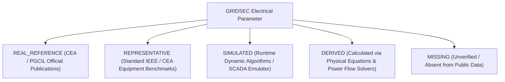

# GRIDSEC — Electrical Power System Model Audit & Cyber-Physical Simulation Specification

## Executive Summary & Objective

**GRIDSEC** is evolving from a topological graph & DSA resilience platform (BFS, DFS, Dijkstra, Priority Queue, Inverted Index) into a high-fidelity **Cyber-Physical Power Grid Platform**. 

The goal of this audit is to systematically catalog all electrical parameters currently present across our datasets and backend services, classify their provenance with zero fabrication, specify the mathematical and database entities required for an engineering-grade power-flow solver (such as **pandapower** / **PyPSA** / **Newton-Raphson**), and define the architectural boundary between **Network Graph DSA Algorithms** and **Electrical Power Systems Physics**.

---

## 1. Existing Electrical Data Audit

An inspection of [js/data/indiaGridData.js](file:///c:/Users/karti/Desktop/sem3/dsa/Project/js/data/indiaGridData.js), database models ([backend/app/models/](file:///c:/Users/karti/Desktop/sem3/dsa/Project/backend/app/models/)), schemas, ingestion pipelines, and telemetry services reveals the following existing parameters:

| Asset Type | Available Field | Unit / Type | Description / Grounding | Data Classification |
| :--- | :--- | :--- | :--- | :--- |
| **Power Plant (33 units)** | `name`, `asset_id` | String | Station identifier (e.g. Vindhyachal Super Thermal, Bhakra Nangal Hydro, Kakrapar Nuclear, Khavda Solar) | `REAL_REFERENCE` |
| | `capacityMW` | MW (Float) | Nameplate Installed Generation Capacity from CEA publications | `REAL_REFERENCE` |
| | `voltage` | kV (String) | Terminal step-up voltage level (765kV, 400kV, 220kV) | `REAL_REFERENCE` |
| | `lat`, `lon` | Degrees (Float)| Exact geographic coordinates | `REAL_REFERENCE` |
| | `operator`, `operatorId` | String | Generating utility (NTPC, NHPC, NPCIL, Adani Power, Tata Power, etc.) | `REAL_REFERENCE` |
| | `type` | String | Fuel generation type (`thermal_plant`, `hydro_plant`, `nuclear_plant`, `solar_plant`) | `REAL_REFERENCE` |
| | `currentMW` | MW (Float) | Nominal operating generation snapshot | `REPRESENTATIVE` |
| **Substation & Hub (26 units)**| `name`, `asset_id` | String | Substation name (e.g. Raigarh UHVDC Hub, Wardha 765kV Substation, Delhi Dadri Hub) | `REAL_REFERENCE` |
| | `voltage` | kV (String) | Operating voltage classes (±800kV HVDC, ±500kV HVDC, 765kV, 400kV, 220kV) | `REAL_REFERENCE` |
| | `capacityMW` | MW (Float) | Maximum substation transformation / handling throughput rating | `REAL_REFERENCE` |
| | `transformers` | Array (85 total)| List of monitored transformer bays associated with switchyard | `REAL_REFERENCE` |
| | `pincode`, `district` | String | Accurate postal and district indexing | `REAL_REFERENCE` |
| | `operator` | String | Transmission licensee (PGCIL, POWERGRID, DTL, GETCO, OPTCL, etc.) | `REAL_REFERENCE` |
| **Transmission Corridor (54 lines)**| `id`, `name` | String | Transmission line designator (e.g. `LINE-HVDC-RAI-PUG`) | `REAL_REFERENCE` |
| | `from`, `to` | Asset IDs | Terminating substations (Source and Destination endpoints) | `REAL_REFERENCE` |
| | `type` | String | Line classification (`HVDC`, `765kV_AC`, `400kV_AC`) | `REAL_REFERENCE` |
| | `voltage` | String | Operating voltage (`±800 kV`, `±500 kV`, `765 kV AC`, `400 kV AC`) | `REAL_REFERENCE` |
| | `distanceKm` | km (Float) | Physical transmission corridor line length | `REAL_REFERENCE` |
| | `capacityMW` | MW (Float) | Maximum continuous thermal / Surge Impedance Loading (SIL) limit | `REAL_REFERENCE` |
| | `direction` | String | Inter-regional power transfer direction (e.g. WR → SR, WR → NR) | `REAL_REFERENCE` |
| | `currentFlowMW` | MW (Float) | Nominal SCADA power flow snapshot | `REPRESENTATIVE` |
| **Transformer Bay (85 bays)** | `id`, `name` | String | Transformer bay tag (e.g. `XFMR-DEL-ICT1`) | `REAL_REFERENCE` |
| | `type` | String | Transformer category (`ICT`, `Converter XFMR`, `GSU`, `DT`) | `REAL_REFERENCE` |
| | `ratingMVA` | MVA (Float) | Installed nameplate apparent power rating (e.g. 1500 MVA, 750 MVA, 500 MVA, 315 MVA)| `REAL_REFERENCE` |
| | `primaryKV`, `secondaryKV` | kV (Float) | Step-down transformation ratio (e.g. 765/400kV, 400/220kV) | `REAL_REFERENCE` |
| | `cooling` | String | Cooling mechanism (`ODAF`, `ONAF`, `ONAN`) | `REAL_REFERENCE` |
| | `tapPosition` | Integer | On-Load Tap Changer (OLTC) tap setting (1 to 17) | `REPRESENTATIVE` |
| | `loadPercent` | % (Float) | Operating load utilization percentage | `SIMULATED` |
| | `oilTempC`, `windingTempC`| °C (Float) | Top oil and hot-spot winding temperatures | `SIMULATED` |
| | `dgaStatus` | String | Dissolved Gas Chromatography status (e.g. H2, CH4, C2H2 ppm) | `SIMULATED` |
| **Grid Telemetry** | `gridFrequencyHz` | Hz (Float) | Real-time frequency (governed around IEGC standard 50.00 Hz) | `SIMULATED` |
| | `nationalDemandMW` | MW (Float) | Aggregate grid demand | `SIMULATED` |
| | `totalGenerationMW` | MW (Float) | Aggregate grid generation | `SIMULATED` |

---

## 2. Missing Electrical Data for Realistic Power Flow

To execute an AC Newton-Raphson or Fast-Decoupled power flow calculation, the following engineering parameters are required and are currently **missing** from raw public registries:

1. **Branch Impedances ($R, X, B$)**:
   - Positive sequence resistance per kilometer ($r_{1}$ in $\Omega/\text{km}$)
   - Positive sequence reactance per kilometer ($x_{1}$ in $\Omega/\text{km}$)
   - Shunt susceptance per kilometer ($b_{1}$ in $\mu\text{S}/\text{km}$ or charging capacitance $c_{1}$ in $\text{nF}/\text{km}$)
   - Zero sequence parameters ($r_{0}, x_{0}, b_{0}$) for unsymmetrical fault analysis
2. **Transformer Short-Circuit Parameters**:
   - Short-circuit voltage percentage ($v_k\%$)
   - Real part of short-circuit voltage / copper loss percentage ($v_{kr}\%$)
   - Open-circuit magnetization current ($i_0\%$) and iron core loss ($P_{fe}$ in kW)
3. **Generator Dynamic Reactive Limits**:
   - Minimum reactive power capability ($Q_{\min}$ in MVAr, under-excited limit)
   - Maximum reactive power capability ($Q_{\max}$ in MVAr, over-excited limit)
   - Voltage setpoint ($V_{\text{setpoint}}$ in per-unit)
   - Generator sub-transient reactance ($X''_d$) and inertia constant ($H$ in seconds)
4. **Time-Varying Load Profiles**:
   - Real-time active demand ($P_{\text{load}}$ in MW) per bus
   - Reactive demand ($Q_{\text{load}}$ in MVAr) or continuous power factor ($\cos \phi$)
   - Voltage-dependent load characteristics (ZIP load coefficients: Constant Impedance $Z$, Constant Current $I$, Constant Power $P$)
5. **Bus Voltage Angle & Magnitude State**:
   - Actual instantaneous PMU synchrophasor bus voltage angles ($\theta$ in degrees) relative to the reference slack bus.

---

## 3. Strict Classification of Electrical Parameters

GRIDSEC enforces strict separation among five data classifications:



1. **`REAL_REFERENCE`**: Parameters grounded in public data from Central Electricity Authority (CEA), POWERGRID (PGCIL), and Grid-India (POSOCO). Examples: Substation coordinates, installed transformer MVA ratings, corridor lengths in km, rated transmission voltages, installed generator MW capacities.
2. **`REPRESENTATIVE`**: Standard engineering parameters derived from published IEEE / CEA standard equipment catalogs (e.g. ACSR Quad-Bersimis conductor $R/X$ values for 765kV lines, standard 14.5% $v_k\%$ for 765/400kV ICTs).
3. **`SIMULATED`**: Values produced by GRIDSEC's live runtime engines to emulate physical variations (e.g., 50.002 Hz frequency drift, transformer DGA hydrogen ppm, SCADA telemetry noise).
4. **`DERIVED`**: Values computed mathematically from physical equations once the power flow solver runs (e.g., $I^2 R$ active transmission losses, voltage phase angle $\theta$, bus voltage magnitude $|V|$, reactive power balance $\sum Q$, branch loading percentage).
5. **`MISSING`**: Engineering parameters that are currently unverified or omitted in public releases (e.g., sub-second breaker impedances, ground mat resistances).

---

## 4. Fundamental Distinctions: Capacity vs. Flow vs. Loading

To maintain engineering accuracy, GRIDSEC strictly differentiates between three related but non-interchangeable concepts:

$$\text{Capacity (MW / MVA)} \neq \text{Actual Power Flow (MW / MVAr)} \neq \text{Loading (\% Utilization)}$$

- **Capacity ($P_{\max} / S_{\text{rated}}$)**: The physical continuous design rating or thermal transfer limit of an asset (e.g., 6000 MW for Raigarh–Pugalur UHVDC line, 1500 MVA for a 765/400kV ICT). This is a fixed engineering constraint (`REAL_REFERENCE`).
- **Actual Power Flow ($P + jQ$)**: The instantaneous active and reactive electrical energy transmitted across the conductor or transformer winding at a specific moment in time (e.g., 4210 MW active, 1180 MVAr reactive). This is state-dependent (`DERIVED` via power flow or `REPRESENTATIVE` from SCADA snapshots).
- **Loading ($\%$ Utilization)**: The dimensionless ratio of actual power throughput to rated capacity:
  $$\text{Loading}_{\text{branch}} = \frac{\sqrt{P^2 + Q^2}}{S_{\text{rated}}} \times 100\%$$
  This indicates thermal stress and proximity to N-1 contingency limits (`DERIVED`).

---

## 5. Clean Separation of Network Graph DSA Engine vs. Electrical Physics Model

```
                         GRID SEC DATA ARCHITECTURE
                                     |
                +--------------------+--------------------+
                |                                         |
                ▼                                         ▼
        NETWORK GRAPH (DSA)                     ELECTRICAL MODEL (PHYSICS)
  [backend/app/dsa/ & backend/app/services/]     [backend/app/power/]
                |                                         |
    • BFS Cyber Blast Radius                     • Electrical Buses (Slack, PV, PQ)
    • Dijkstra Dynamic Rerouting                 • Generators (MW, MVAr limits, Vset)
    • DFS Islanding & Loop Detection             • Loads (P demand MW, Q demand MVAr)
    • Max-Heap Incident Priority Queue           • Transmission Lines (R, X, B, length)
    • O(1) Inverted Index Hash Table             • Transformers (MVA, vk%, tap ratio)
                |                                         |
                +--------------------+--------------------+
                                     |
                                     ▼
                       CYBER-PHYSICAL ENGINE
      [Cyber Incident -> Breaker Trip -> Rebuild Bus-Branch -> Power Flow Solver
       -> Voltage Collapse & Overload Check -> BFS Blast Spread -> Dijkstra Detour]
```

- **The Network Graph answers**: *"How are assets connected and how does a cyber compromise topologically spread?"*
- **The Electrical Model answers**: *"How do voltage vectors, phase angles, reactive power, and thermal overloads physically distribute across those connections under Ohm's and Kirchhoff's Laws?"*

---

## 6. Electrical Data Schema & Model Design

The electrical layer in [backend/app/power/models.py](file:///c:/Users/karti/Desktop/sem3/dsa/Project/backend/app/power/models.py) defines the following entities:

### 1. `BusModel`
```python
class BusModel(BaseModel):
    bus_id: str                   # e.g. "BUS-DEL-765"
    asset_id: str                 # Foreign key to Asset e.g. "NR-DELHI"
    name: str                     # "Delhi Dadri 765kV Busbar"
    voltage_kv: float             # Base nominal voltage (e.g. 765.0 kV, strictly > 0)
    bus_type: BusType             # SLACK, PV, PQ
    voltage_magnitude_pu: float   # Per-unit voltage magnitude |V| (0.5 - 1.5 pu)
    voltage_angle_deg: float      # Phase angle theta (degrees)
    status: str                   # ONLINE, OUT_OF_SERVICE, ISOLATED
    provenance: DataProvenance
```

### 2. `GeneratorModel`
```python
class GeneratorModel(BaseModel):
    generator_id: str             # e.g. "GEN-KORBA-1"
    bus_id: str                   # Injected busbar
    asset_id: str                 # Parent power plant
    name: str                     # "Korba STPS Units 1-6"
    fuel_type: str                # THERMAL, HYDRO, NUCLEAR, SOLAR, WIND
    rated_power_mw: float         # Nameplate Capacity (MW, strictly > 0)
    current_power_mw: float       # Scheduled active dispatch (MW)
    reactive_power_mvar: float    # Instantaneous reactive dispatch (MVAr)
    voltage_kv: float             # Terminal voltage rating (kV)
    power_factor: float           # Operating power factor (0.5 - 1.0)
    p_min_mw: float               # Minimum stable operating threshold (MW)
    p_max_mw: float               # Maximum active power limit (MW)
    q_min_mvar: float             # Minimum reactive absorption limit (MVAr)
    q_max_mvar: float             # Maximum reactive injection limit (MVAr)
    status: str                   # ONLINE, TRIPPED, MUST_RUN
    provenance: DataProvenance
```

### 3. `LoadModel`
```python
class LoadModel(BaseModel):
    load_id: str                  # e.g. "LOAD-NCR-DELHI"
    bus_id: str                   # Withdrawn busbar
    asset_id: str                 # Associated Substation
    name: str                     # "Delhi Metro Urban Feeder"
    demand_mw: float              # Active demand (MW, >= 0)
    reactive_demand_mvar: float   # Reactive demand (MVAr)
    power_factor: float           # Assumed / measured power factor
    load_type: str                # URBAN_DOMESTIC, INDUSTRIAL, AGRICULTURAL
    status: str                   # ONLINE, SHED, RESTRICTED
    provenance: DataProvenance
```

### 4. `TransmissionLineModel`
```python
class TransmissionLineModel(BaseModel):
    line_id: str                  # e.g. "LINE-765-AGR-DEL"
    source_bus_id: str            # From bus
    destination_bus_id: str       # To bus
    name: str                     # "Agra - Delhi 765kV Double Circuit"
    voltage_kv: float             # Operating voltage (kV, > 0)
    line_type: str                # 765kV_AC, 400kV_AC, HVDC
    length_km: float              # Physical length (km, >= 0)
    rated_capacity_mw: float      # Thermal / SIL capacity (MW, > 0)
    r_ohm_per_km: Optional[float] # Positive sequence resistance (Ohm/km)
    x_ohm_per_km: Optional[float] # Positive sequence reactance (Ohm/km)
    b_microsiemens_per_km: Optional[float] # Shunt susceptance (uS/km)
    current_flow_mw: float        # Active power flow (MW)
    loading_percent: float        # Branch loading %
    losses_mw: Optional[float]    # I^2 * R loss (DERIVED by solver)
    status: str                   # IN_SERVICE, OUT_OF_SERVICE, OVERLOADED
    provenance: DataProvenance
```

### 5. `TransformerModel`
```python
class TransformerModel(BaseModel):
    transformer_id: str           # e.g. "XFMR-DEL-ICT1"
    source_bus_id: str            # Primary high-voltage bus
    destination_bus_id: str       # Secondary low-voltage bus
    asset_id: str                 # Parent switchyard
    name: str                     # "765/400kV 1500MVA ICT-1"
    transformer_type: str         # ICT, Converter XFMR, GSU, DT
    rated_mva: float              # Nameplate apparent power rating (MVA, > 0)
    primary_voltage_kv: float     # Primary nominal voltage (kV)
    secondary_voltage_kv: float   # Secondary nominal voltage (kV)
    vk_percent: Optional[float]   # Short-circuit impedance % (vk%)
    vkr_percent: Optional[float]  # Ohmic copper loss % (vkr%)
    tap_ratio: float              # Turns ratio (0.8 - 1.2)
    tap_pos: int                  # Current OLTC tap position
    loading_percent: float        # Transformer loading %
    losses_mw: Optional[float]    # Core + copper losses (DERIVED)
    status: str                   # IN_SERVICE, OUT_OF_SERVICE, TRIPPED
    provenance: DataProvenance
```

---

## 7. Benchmark 4-Bus Validation Test Network (`TEST_NETWORK`)

To rigorously validate the future power-flow solver without coupling it prematurely to the 59-node national grid, we created an isolated 4-bus validation test system in [backend/app/power/test_networks.py](file:///c:/Users/karti/Desktop/sem3/dsa/Project/backend/app/power/test_networks.py):

```
                   [ Generator Gen-1 (Slack, 2500 MW) ]
                                    |
                           [ Bus 1: 765 kV ]
                             /            \
        Line 1 (765kV, 120km)              Line 2 (765kV, 150km)
                           /                \
                 [ Bus 2: 765 kV ]       [ Bus 3: 765 kV ]
                           \                /
                 XFMR 1 (765/400kV)      XFMR 2 (765/400kV)
                 1500 MVA, vk=14.5%      1500 MVA, vk=14.5%
                           \                /
                           [ Bus 4: 400 kV ]
                                    |
                      [ Load-1 (1200 MW, 300 MVAr) ]
```

### Test Network Parameters:
- **Bus 1 (Slack)**: $V = 1.02\angle 0^\circ\text{ pu}, V_{\text{base}} = 765\text{ kV}$. Generator: $P_{\max} = 2500\text{ MW}, P_{\text{scheduled}} = 1250\text{ MW}, Q_{\text{dispatch}} = 310\text{ MVAr}$.
- **Bus 2 (PQ Switchyard)**: $V_{\text{base}} = 765\text{ kV}$.
- **Bus 3 (PQ Switchyard)**: $V_{\text{base}} = 765\text{ kV}$.
- **Bus 4 (PQ Load Center)**: $V_{\text{base}} = 400\text{ kV}$. Load: $P_{\text{load}} = 1200\text{ MW}, Q_{\text{load}} = 300\text{ MVAr}$ ($\text{pf} = 0.97$).
- **765kV Lines (Quad-Bersimis ACSR)**: $r = 0.018\,\Omega/\text{km}, x = 0.280\,\Omega/\text{km}, b = 4.25\,\mu\text{S}/\text{km}, \text{Rating} = 3000\text{ MW}$.
- **ICTs (765/400 kV, 1500 MVA)**: $v_k\% = 14.5\%, v_{kr}\% = 0.25\%, \text{Tap} = 1.0$.

---

## 8. Power Flow REST API & Staging Interface

The REST API interface is defined and exposed under `/api/power-flow` in [backend/app/api/routes/power_flow.py](file:///c:/Users/karti/Desktop/sem3/dsa/Project/backend/app/api/routes/power_flow.py):

| Method | Endpoint | Description |
| :--- | :--- | :--- |
| `GET` | `/api/power-flow/status` | Reports solver target (`pandapower`), active validation engine, and supported electrical metrics |
| `GET` | `/api/power-flow/networks` | Lists available simulation topologies (`TEST_NETWORK` vs `INDIA_GRID_59`) |
| `GET` | `/api/power-flow/networks/{id}` | Returns full electrical bus-branch topology with attached data provenance |
| `POST` | `/api/power-flow/run` | Validates electrical constraints and stages the simulation for the numerical solver |

### Sample POST `/api/power-flow/run` Payload:
```json
{
  "network_id": "TEST_NETWORK",
  "scenario_id": "BASE_CASE",
  "algorithm": "NEWTON_RAPHSON",
  "tolerance": 1e-5,
  "max_iterations": 30,
  "enforce_reactive_limits": true
}
```

### Staging Response:
```json
{
  "status": "STAGED_FOR_SOLVER",
  "message": "Electrical bus-branch model validated and successfully staged. Numerical solver engine interface ready for pandapower / Newton-Raphson coupling.",
  "network_id": "TEST_NETWORK",
  "scenario_id": "BASE_CASE",
  "timestamp": "2026-09-06T15:58:00.000Z",
  "buses": [...],
  "generators": [...],
  "loads": [...],
  "lines": [...],
  "transformers": [...],
  "system_summary": {
    "total_generation_mw": 1250.0,
    "total_load_mw": 1200.0,
    "total_losses_mw": 0.0,
    "total_reactive_generation_mvar": 310.0,
    "total_reactive_load_mvar": 300.0,
    "total_reactive_losses_mvar": 0.0,
    "slack_bus_id": "TEST-BUS-1",
    "slack_generation_mw": 0.0,
    "max_line_loading_percent": 20.5,
    "converged": false,
    "iterations": 0
  },
  "execution_time_ms": 1.25,
  "solver_backend": "GRIDSEC_POWER_STAGING_ENGINE (pandapower / PyPSA Target)",
  "provenance": {
    "data_source": "GRIDSEC_POWER_STAGING_ENGINE",
    "source_url": "docs/electrical_model.md",
    "data_classification": "DERIVED",
    "verification_status": "ESTIMATED"
  }
}
```

---

## 9. Telemetry Architecture & Future State Derivation Pipeline

### Current Telemetry Audit:
- **Random Variations**: Frequency noise ($\pm 0.04\text{ Hz}$ around 50.00 Hz), voltage fluctuations ($\pm 1.5\%$), power factor jitter (0.94 - 0.99).
- **Rule-Based**: IEGC standard band enforcement (49.90 - 50.05 Hz), DGA threshold classifications (Normal vs Warning vs Critical based on ppm limits).
- **Derived**: National aggregate demand and generation sums, active inter-regional transfer totals.
- **Fixed**: Base nominal voltages (765kV, 400kV, 220kV), asset geographic coordinates, transformer MVA ratings.

### Future State Pipeline:
Rather than generating isolated random numbers, the future telemetry engine will derive physical quantities directly from the power flow solver:

```
+-------------------------------------------------------------+
|                      GRID STATE / TOPOLOGY                  |
|          (Active Breakers, Generator Dispatches, Loads)      |
+-------------------------------------------------------------+
                              │
                              ▼
+-------------------------------------------------------------+
|               ELECTRICAL POWER FLOW SOLVER                  |
|    (Solves non-linear power equations: P_i, Q_i, V_i, θ_i)  |
+-------------------------------------------------------------+
                              │
                              ▼
+-------------------------------------------------------------+
|                PHYSICAL ELECTRICAL QUANTITIES               |
|      (Branch MW/MVAr Flows, Bus Voltages, I^2*R Losses)      |
+-------------------------------------------------------------+
                              │
                              ▼
+-------------------------------------------------------------+
|             SCADA / PMU SYNCHROPHASOR TELEMETRY             |
|   (Injects realistic transducer noise & time-series ticks)  |
+-------------------------------------------------------------+
                              │
                              ▼
+-------------------------------------------------------------+
|           CYBERSECURITY & RESILIENCE MONITORING             |
|       (Detects MITM spoofing, FDI attacks, DoS delays)      |
+-------------------------------------------------------------+
```

---

## 10. Solver Integration Plan (Pandapower / Newton-Raphson)

The power-system solver will be integrated cleanly through the existing abstraction layer in [backend/app/power/](file:///c:/Users/karti/Desktop/sem3/dsa/Project/backend/app/power/):

1. **Step 1 (Pandapower Bridge)**: In `backend/app/power/solver.py`, map `BusModel` $\rightarrow$ `pp.create_bus()`, `GeneratorModel` $\rightarrow$ `pp.create_gen()`, `LoadModel` $\rightarrow$ `pp.create_load()`, `TransmissionLineModel` $\rightarrow$ `pp.create_line_from_parameters()`, `TransformerModel` $\rightarrow$ `pp.create_transformer_from_parameters()`.
2. **Step 2 (Execution)**: Call `pp.runpp(net, algorithm='nr', enforce_q_lims=True)`.
3. **Step 3 (Result Translation)**: `result_parser.py` reads `net.res_bus`, `net.res_line`, `net.res_trafo`, `net.res_gen` and populates the strongly-typed `PowerFlowResponse`.
4. **Step 4 (Validation)**: First verify convergence and power balance on `TEST_NETWORK`. Once verified within $< 10^{-5}$ tolerance, enable the solver on the 59-node `INDIA_GRID_59` reference model.

---

## 11. Known Limitations & Realistic Constraints

1. **Sub-Transmission & Distribution Omission**: GRIDSEC models the bulk transmission network (765kV, 400kV, 220kV, HVDC). 66kV, 33kV, and 11kV distribution feeders are aggregated into bulk bus loads.
2. **Dynamic Stability & Sub-Transient Phasors**: The initial power-flow solver addresses steady-state AC/DC power flow ($P, Q, V, \theta$). Transient electromechanical rotor angle stability (Swing equation $M \frac{d^2\delta}{dt^2} = P_m - P_e$) requires dynamic differential-algebraic equation (DAE) solvers.
3. **HVDC Converter Equations**: Steady-state HVDC bipoles are modeled as controlled active power injection/withdrawal pairs with designated commutating reactive requirements ($\approx 0.5 \cdot P_{\text{DC}}$) rather than full 12-pulse thyristor firing angle ($\alpha, \gamma$) dynamics.
4. **Public Data Approximations**: Where specific conductor types (e.g. Moose vs Bersimis vs Zebra) are unlisted for a specific historical line, standard CEA transmission planning benchmark parameters are applied and explicitly tagged as `REPRESENTATIVE`.
